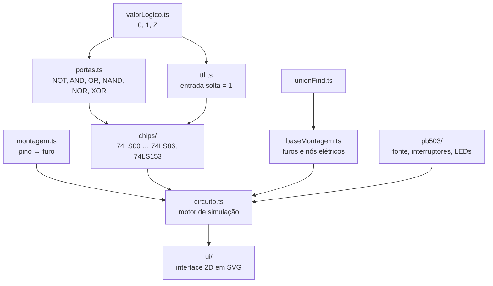

# Simulador PB-503

> **Versão beta, em desenvolvimento.**
> Simulador interativo da base de montagem **Global Specialties PROTO-BOARD PB-503**, usada nos laboratórios de **Fundamentos de Arquitetura de Computadores (FAC)** do ISCTE.

Monta circuitos integrados da série 74LS, liga fios, mexe nos interruptores e vê o resultado nos LEDs, tudo no browser, tal como na placa real do laboratório.

**Experimenta online:** [simulador-pb503.vercel.app](https://simulador-pb503.vercel.app)

---

## Índice

1. [Motivação](#motivação)
2. [Uso de inteligência artificial](#uso-de-inteligência-artificial)
3. [Funcionalidades](#funcionalidades)
4. [Guia rápido de utilização](#guia-rápido-de-utilização)
5. [Instalação e execução](#instalação-e-execução)
6. [Estrutura do projeto](#estrutura-do-projeto)
7. [Arquitetura](#arquitetura)
8. [O modelo lógico](#o-modelo-lógico)
9. [Os circuitos integrados](#os-circuitos-integrados)
10. [A base de montagem e os nós elétricos](#a-base-de-montagem-e-os-nós-elétricos)
11. [O motor de simulação](#o-motor-de-simulação)
12. [A interface 2D](#a-interface-2d)
13. [Testes](#testes)
14. [Decisões de desenho](#decisões-de-desenho)
15. [Convenções do projeto](#convenções-do-projeto)
16. [Limitações conhecidas](#limitações-conhecidas)
17. [Registo de alterações](#registo-de-alterações)
18. [Autor e contactos](#autor-e-contactos)
19. [Aviso legal](#aviso-legal)

---

## Motivação

Sou estudante de Engenharia Informática no ISCTE e, na cadeira de Fundamentos de Arquitetura de Computadores, os laboratórios são feitos numa base de montagem PB-503: chips da série 74LS, fios, interruptores e LEDs. Quis construir um simulador dessa placa por três razões:

- **Aprender as bases a sério.** Já tinha alguma experiência com JavaScript, Git e *pull requests*, mas queria perceber de verdade como as coisas funcionam, em vez de copiar código. Por isso desenvolvi este projeto passo a passo, de forma didática: primeiro a lógica, depois os testes, só no fim a interface. Cada conceito novo (tipos, classes, testes unitários, union-find, simulação por ponto fixo, SVG…) foi aprendido e aplicado no momento em que fazia falta.
- **Ligar a teoria à prática.** Ao programar a placa, tive de pensar em perguntas que nas aulas passam despercebidas: o que acontece a uma entrada solta num chip TTL? Porque é que um chip sem alimentação não faz nada? O que é, exatamente, um curto-circuito? O simulador responde a estas perguntas com o mesmo rigor que a placa real.
- **Criar uma ferramenta útil para estudar.** Poder montar e testar os circuitos dos laboratórios em casa, antes da aula, e perceber os erros de montagem mais comuns.

O projeto está todo **em português** (código, testes e documentação).

---

## Uso de inteligência artificial

Por transparência: este projeto foi desenvolvido com o apoio de um assistente de inteligência artificial (Claude, da Anthropic), usado como tutor ao longo do processo.

- **Interface (front-end).** A IA foi usada **maioritariamente na parte do front-end**: a interface 2D em SVG, o layout, o zoom e deslocamento, as dicas e os estilos.
- **Union-find.** A IA ajudou-me bastante a perceber e a aplicar o algoritmo **union-find**, que é o que permite saber que furos da breadboard estão ligados entre si (os nós elétricos).
- **Como trabalhei.** O projeto foi construído passo a passo, de forma didática: cada conceito foi explicado antes de ser usado, o código foi revisto e corrigido ao longo do caminho, e todas as decisões de desenho (os três estados, o comportamento TTL, a geometria da placa a partir do enunciado e das fotografias da PB-503, a nomenclatura em português) foram discutidas e tomadas por mim.

O comportamento do simulador está verificado por mais de 200 testes unitários e pela montagem do Laboratório 1, comparada com a placa real.

---

## Funcionalidades

**Componentes da PB-503**
- Barra de alimentação com as filas **+5 V** e **0 V** (as filas **+V** e **−V** são representadas visualmente).
- **Três breadboards** completas: colunas de 5 furos, canal central e filas de barramento.
- **Interruptores lógicos S1–S8** e **8 pares de LEDs** (vermelho = 1, verde = 0, apagado = sem valor).
- Interruptor geral **POWER**.

**Circuitos integrados** (série 74LS, encapsulamentos DIP-14 e DIP-16)

| Chip | Função |
|---|---|
| 74LS00 | 4 portas NAND de 2 entradas |
| 74LS02 | 4 portas NOR de 2 entradas |
| 74LS04 | 6 inversores (NOT) |
| 74LS08 | 4 portas AND de 2 entradas |
| 74LS32 | 4 portas OR de 2 entradas |
| 74LS86 | 4 portas XOR de 2 entradas |
| 74LS153 | 2 multiplexadores 4:1 com seleção comum (DIP-16) |

**Simulação**
- Lógica de **três estados** (0, 1 e Z) e comportamento **TTL** (entrada solta lida como 1).
- Chips sem alimentação ficam com as saídas indefinidas.
- Deteção de **curtos-circuitos** (duas saídas a forçar valores diferentes no mesmo ponto).
- Deteção de circuitos que **nunca estabilizam** (oscilações).

**Interface**
- Montar chips e ligar fios com o rato; apagar fios e chips.
- **Sombra do chip** antes de o montar, com os furos livres a verde e os ocupados a vermelho.
- **Ponta de prova**: ao passar o rato por um furo, destaca todos os pontos ligados e mostra o valor e o que está ligado a esse ponto.
- **Dicas** em português claro sobre furos, fios e chips (incluindo o diagnóstico da alimentação dos chips).
- **Zoom e deslocamento** ao estilo do Figma.
- Exemplo pronto a carregar: **Laboratório 1**.
- Página inicial com uma **faixa de novidades** que mostra as últimas atualizações do simulador.

---

## Guia rápido de utilização

### As ferramentas

| Ferramenta | O que faz |
|---|---|
| **Usar** | Clica nos interruptores S1–S8 e no POWER para testar o circuito. |
| **Ponta de prova** | Passa o rato pelos furos para ver o nó elétrico, o valor e o que está ligado. Clicar mostra o valor nas indicações. |
| **Ligar fio** | Clica num furo e depois noutro. `Esc` cancela. |
| **Circuitos integrados** | Escolhe um chip e clica na coluna onde queres o **pino 1** (linhas A a J de uma breadboard). |
| **Apagar** | Clica num fio ou num chip para o remover. |
| **Limpar placa** | Remove tudo. |

### Zoom e deslocamento

| Gesto | Efeito |
|---|---|
| `Ctrl` + roda do rato, ou pinça no touchpad | Aproximar e afastar (centrado no cursor) |
| Roda do rato, ou dois dedos no touchpad | Deslocar |
| `Espaço` + arrastar, ou botão do meio do rato | Deslocar |
| Botões **−**, **+** e **Ajustar** | Zoom no centro e voltar à placa inteira |

### Exemplo: montar o Laboratório 1 à mão

O circuito do Laboratório 1 calcula **F = A2 · A0 · A1** com duas portas AND de um 74LS08.

1. Escolhe o **74LS08** e clica no furo **F10** da breadboard 1 (o pino 1 fica na coluna 10).
2. Com **Ligar fio**, liga o **pino 14** (VCC) à fila **+5 V** e o **pino 7** (GND) à fila **0 V**.
3. Liga as entradas e a saída:
   - interruptor **S1** → pino 1 (entrada A2)
   - interruptor **S3** → pino 2 (entrada A0)
   - pino 3 → pino 10 (saída da primeira porta para a entrada da segunda)
   - interruptor **S2** → pino 9 (entrada A1)
   - pino 8 → **LED 1** (saída F)
4. Escolhe **Usar**, liga o **POWER** e experimenta os interruptores: o LED 1 só fica **vermelho** com S1, S2 e S3 em cima.

Também podes carregar o circuito pronto em **Exemplos → Lab 1**.

---

## Instalação e execução

### Requisitos

- [Node.js](https://nodejs.org) (versão LTS; desenvolvido com o Node 22)
- npm (vem com o Node.js)
- Git

### Instalar

```bash
git clone https://github.com/H3ldex/simulador-pb503.git
cd simulador-pb503
npm install
```

### Comandos

| Comando | O que faz |
|---|---|
| `npm run dev` | Arranca o servidor de desenvolvimento (normalmente em `http://localhost:5173`). A página atualiza sozinha ao guardar. |
| `npm test` | Corre todos os testes uma vez. |
| `npm run test:watch` | Corre os testes sempre que um ficheiro muda. |
| `npm run typecheck` | Verifica os tipos da lógica (sem acesso ao browser) e da interface. |
| `npm run build` | Gera a versão final do site na pasta `dist/`. |
| `npx vite preview` | Serve a versão final localmente, para a testar antes de publicar. |

> O Vite e o Vitest **não verificam tipos**, para serem rápidos. Corre sempre o `npm run typecheck` antes de fazer commit.

---

## Estrutura do projeto

```
├── index.html              Página inicial (com a faixa de novidades)
├── simulador.html          Página do simulador
├── vite.config.ts          Configuração do Vite (duas páginas, caminhos relativos)
├── tsconfig.json           TypeScript da lógica (sem DOM)
├── tsconfig.ui.json        TypeScript da interface (com DOM)
├── package.json
│
├── src/                    LÓGICA — não sabe que o browser existe
│   ├── valorLogico.ts      Tipo ValorLogico (0, 1, Z)
│   ├── portas.ts           NOT, AND, OR, NAND, NOR, XOR
│   ├── ttl.ts              Leitura de entradas TTL (solta = 1)
│   ├── pinos.ts            Números dos pinos e encapsulamentos (DIP-14 e DIP-16)
│   ├── chips/
│   │   ├── comum.ts            Alimentação, leitura TTL e saídas indefinidas
│   │   ├── chipDuasEntradas.ts Chips com portas de 2 entradas
│   │   ├── chipUmaEntrada.ts   Chips com portas de 1 entrada (74LS04)
│   │   ├── chipMux153.ts       Multiplexador 4:1 duplo (74LS153)
│   │   └── catalogo74LS.ts     Pinagens e funções criar74LS…
│   ├── unionFind.ts        Estrutura union-find (nós elétricos)
│   ├── baseMontagem.ts     Furos, ligações internas e fios da PB-503
│   ├── montagem.ts         Em que furo fica cada pino de um chip montado
│   ├── pb503/
│   │   ├── fonte.ts            POWER e filas de alimentação
│   │   ├── interruptores.ts    Interruptores S1–S8
│   │   └── indicadores.ts      LEDs
│   ├── circuito.ts         Motor de simulação
│   ├── descricao.ts        Descrições em português de furos e valores
│   └── exemplos/
│       └── lab1.ts             Montagem do Laboratório 1
│
├── ui/                     INTERFACE — usa a lógica, nunca o contrário
│   ├── main.ts             Estado da aplicação, ferramentas e eventos
│   ├── desenho.ts          Desenho da placa em SVG e camada de destaque
│   ├── layout.ts           Posição de cada furo e componente (sem DOM, testável)
│   ├── vista.ts            Contas do zoom e do deslocamento (sem DOM, testável)
│   ├── icones.ts           Ícones desenhados em SVG
│   ├── novidades.ts        Registo de novidades e formatação de datas (sem DOM, testável)
│   ├── inicio.ts           Faixa de novidades da página inicial
│   ├── tema.css            Cores e base comuns às duas páginas
│   ├── estilos.css         Estilos do simulador
│   └── inicio.css          Estilos da página inicial
│
└── tests/                  Testes unitários (Vitest)
```

---

## Arquitetura

O princípio central do projeto é a **separação entre a lógica e a interface**:

- tudo o que está em `src/` é **TypeScript puro**: não usa o browser e é configurado sem os tipos do DOM (`"lib": ["ES2022"]` no `tsconfig.json`). Se alguém escrever `document` na lógica, o compilador dá erro;
- a interface, em `ui/`, tem a sua própria configuração (`tsconfig.ui.json`), **usa** a lógica e limita-se a mostrar o resultado.

Isto permite testar toda a lógica sem browser e, no futuro, trocar a interface 2D por uma 3D (Three.js) sem tocar no motor.



O fluxo da interface é sempre o mesmo:

> **clique → muda o modelo → o circuito é simulado → a página mostra o resultado**

---

## O modelo lógico

### Três estados

Cada ponto do circuito tem um de três valores:

| Valor | Significado | Na placa |
|---|---|---|
| **1** | algo força o ponto a nível alto | +5 V |
| **0** | algo força o ponto a nível baixo | 0 V |
| **Z** | nada força o ponto (alta impedância) | fio solto, chip sem alimentação |

O **Z** não é, por si só, um erro: é a ausência de quem force um valor. Nos laboratórios, costuma ser o sintoma de uma ligação esquecida.

### A regra de ouro para o Z

As tabelas de verdade das aulas só têm 0 e 1. Para estender as portas ao Z (lógica de Kleene), substitui-se o Z por 0 e por 1:

- se os dois resultados forem **iguais**, o Z não importa e o resultado é esse valor;
- se forem **diferentes**, o resultado é **Z**.

Daqui resulta a noção de **elemento absorvente**: na AND, um 0 decide a saída sozinho (AND(0, Z) = 0); na OR, é o 1 (OR(1, Z) = 1). A XOR não tem elemento absorvente: qualquer Z na entrada dá Z na saída.

| A | B | AND | OR | XOR |
|---|---|---|---|---|
| 0 | Z | 0 | Z | Z |
| 1 | Z | Z | 1 | Z |
| Z | Z | Z | Z | Z |

### Portas abstratas vs. chips TTL

Há duas camadas, de propósito:

- **as portas** (`portas.ts`) são lógica abstrata e seguem a regra de ouro;
- **os chips** (`chips/`) representam o hardware real: antes de chamar as portas, convertem cada entrada solta em **1**, como faz a família TTL (74LS).

Consequência prática, muito comum nos laboratórios: uma entrada esquecida faz o circuito **parecer** funcionar quando o valor certo seria 1.

### Tensões

Os sinais usados nos laboratórios são sempre **0 V** ou **+5 V**, por isso o simulador trabalha diretamente com valores lógicos. As filas de tensão variável (+V e −V) e os seletores +5/+V e TTL/CMOS existem apenas visualmente.

---

## Os circuitos integrados

Os chips montam-se a atravessar o canal central da breadboard com a **marca à esquerda**. O pino 1 fica em baixo à esquerda e a numeração segue no sentido contrário ao dos ponteiros do relógio. A posição da alimentação depende do **encapsulamento**:

| Encapsulamento | Pinos | VCC (+5 V) | GND (0 V) | Colunas ocupadas | Chips |
|---|---|---|---|---|---|
| DIP-14 | 14 | pino 14 | pino 7 | 7 | 74LS00, 02, 04, 08, 32, 86 |
| DIP-16 | 16 | pino 16 | pino 8 | 8 | 74LS153 |

```
           14  13  12  11  10   9   8      ← linha E
          ┌───────────────────────────┐
          ◖          74LSxx           │
          └───────────────────────────┘
            1   2   3   4   5   6   7      ← linha F
```

### Pinagens dos chips de portas lógicas (DIP-14)

| Chip | Portas (entradas → saída) |
|---|---|
| 74LS00, 74LS08, 74LS32, 74LS86 | 1, 2 → 3 · 4, 5 → 6 · 9, 10 → 8 · 12, 13 → 11 |
| 74LS02 (a saída vem **antes** das entradas) | 2, 3 → 1 · 5, 6 → 4 · 8, 9 → 10 · 11, 12 → 13 |
| 74LS04 | 1 → 2 · 3 → 4 · 5 → 6 · 9 → 8 · 11 → 10 · 13 → 12 |

Um chip só funciona com o **VCC a 1** e o **GND a 0** (pinos 14 e 7 num DIP-14; pinos 16 e 8 num DIP-16). Caso contrário, todas as saídas ficam em Z.

### O 74LS153: multiplexador 4:1 duplo

Um multiplexador (MUX) é um seletor: copia para a saída **uma** de quatro entradas de dados, escolhida pelas entradas de seleção S1 e S0. O 74LS153 tem dois MUX (a e b), que **partilham** a seleção.

```
          16   15   14   13   12   11   10    9
         VCC   Ēb   S0  I3b  I2b  I1b  I0b   Zb
        ┌──────────────────────────────────────┐
        ◖               74LS153                │
        └──────────────────────────────────────┘
          Ēa   S1  I3a  I2a  I1a  I0a   Za  GND
           1    2    3    4    5    6    7    8
```

| Ē | S1 | S0 | Z |
|---|---|---|---|
| 1 | X | X | 0 |
| 0 | 0 | 0 | I0 |
| 0 | 0 | 1 | I1 |
| 0 | 1 | 0 | I2 |
| 0 | 1 | 1 | I3 |

O **Ē** (*enable*) é **ativo a baixo**: o MUX só funciona com Ē = 0. Atenção à armadilha TTL: um Ē **esquecido** (solto) é lido como 1, e a saída fica sempre a 0.

### Como os chips estão feitos

Cada chip é descrito por **dados**: a pinagem e a função da porta. Por exemplo, o 74LS08 é um `ChipDuasEntradas` com a pinagem padrão e a função `portaAND`. Acrescentar um chip novo da série 74 é, na maior parte dos casos, uma pinagem e três linhas de código.

Chips com uma lógica diferente, como o 74LS153, têm uma classe própria. Basta respeitarem o contrato `ChipLogico` (nome, encapsulamento, `calcularSaidas` e `descreverPino`) para o motor, a montagem, o desenho e as dicas funcionarem com eles sem alterações.

---

## A base de montagem e os nós elétricos

### Geometria

| Peça | Composição |
|---|---|
| Barra de alimentação | 4 filas de 50 furos, cada uma ligada de ponta a ponta: +5 V, +V, −V, 0 V |
| 3 breadboards | 64 colunas, cada uma com dois grupos de 5 furos (A–E e F–J), separados pelo canal central |
| Barramentos das breadboards | 2 filas em cima e 2 em baixo, cada uma com duas metades independentes de 25 furos |
| Terminais | 2 furos por interruptor (S1–S8) e 2 por LED (1–8) |

As três breadboards somam **2520 pontos de ligação**, o mesmo número da placa de substituição oficial da PB-503.

### Nomes dos furos

| Furo | Significado |
|---|---|
| `P1:C:7` | breadboard 1, linha C, coluna 7 |
| `P2:S1:30` | breadboard 2, 1.ª fila de barramento de cima, furo 30 |
| `ALIM:+5V:12` | barra de alimentação, fila +5 V, furo 12 |
| `INT:3:1` | 1.º furo do terminal do interruptor S3 |
| `LED:1:2` | 2.º furo do terminal do LED 1 |

### Union-find

Um **nó elétrico** é um grupo de pontos ligados entre si: eletricamente, são o mesmo fio. Para saber rapidamente que furos pertencem ao mesmo nó, o projeto usa a estrutura **union-find** (conjuntos disjuntos):

- cada grupo tem um "chefe" (representante);
- `encontrar(x)` segue os "pais" até chegar ao chefe;
- `unir(a, b)` junta os dois grupos ligando **chefe a chefe**;
- dois furos estão ligados se e só se tiverem o mesmo chefe.

As ligações internas da placa (colunas, filas) e cada fio são uniões. Como o union-find não sabe desfazer uniões, **remover um fio** reconstrói a base a partir dos fios que restam.

---

## O motor de simulação

O motor (`circuito.ts`) distingue dois tipos de componentes em cada nó:

| Tipo | O que faz | Exemplos |
|---|---|---|
| **Condutor** | força um valor no nó | filas +5 V e 0 V, interruptores, saídas dos chips |
| **Leitor** | só lê o valor | entradas dos chips, LEDs |

Um nó pode ter **quantos leitores quiser**, mas **no máximo um condutor** a forçar um valor.

### Propagação até ao ponto fixo

1. Começa com todos os nós soltos.
2. Recolhe as **contribuições** de todos os condutores. Os chips calculam as saídas a partir dos valores **atuais** dos nós.
3. **Resolve** cada nó: sem contribuições → Z; só 0 → 0; só 1 → 1; 0 **e** 1 → **curto-circuito** (o nó fica Z e o conflito é registado).
4. Se os valores não mudaram, o circuito **estabilizou**. Senão, repete a partir do passo 2.

Se ao fim de 100 repetições o circuito ainda não estabilizou (por exemplo, uma NOT com a saída ligada à própria entrada), o motor indica que o circuito **oscila**.

---

## A interface 2D

- **SVG**: a placa é desenhada em unidades próprias (1 passo = distância entre furos = 2,54 mm na placa real) e o `viewBox` faz o desenho caber em qualquer ecrã.
- **Duas camadas**: a placa é redesenhada quando o circuito muda; a **camada de destaque** (ponta de prova, sombra do chip) é redesenhada a cada movimento do rato, para a interface continuar rápida.
- **Zoom**: mudar o zoom é só mudar o `viewBox`, sem redesenhar a placa. As contas estão em `vista.ts`, testadas.
- **Dicas em HTML**: ficam por cima da placa e mantêm sempre o mesmo tamanho, seja qual for o zoom.
- **Ferramentas como modos**: o estado da aplicação é o circuito, a ferramenta ativa e a mensagem de indicação. Cada ação muda o estado e chama `atualizar()`.

---

## Testes

O projeto tem **mais de 200 testes unitários** (Vitest). As tabelas de verdade das aulas estão escritas diretamente como testes.

| Ficheiro | O que testa |
|---|---|
| `valorLogico.test.ts` | Valores definidos e indefinidos |
| `portas.test.ts` | As 6 portas, de forma **exaustiva** (todas as combinações de 0, 1 e Z) |
| `ttl.test.ts` | Leitura de entradas TTL |
| `chip74LS08.test.ts` | Alimentação, comportamento TTL e ligações das 4 portas |
| `catalogo74LS.test.ts` | Os 6 chips de portas contra as tabelas de verdade, pinagens e descrição dos pinos |
| `chipMux153.test.ts` | O 74LS153: alimentação em DIP-16, as 4 seleções dos dois multiplexadores e o enable |
| `unionFind.test.ts` | Propriedades do union-find (simetria, transitividade…) |
| `baseMontagem.test.ts` | Ligações internas, fios, terminais e nós da PB-503 |
| `montagem.test.ts` | Posição dos pinos de um chip montado, em DIP-14 e DIP-16 |
| `fonte.test.ts`, `interruptores.test.ts`, `indicadores.test.ts` | Componentes da PB-503 |
| `circuito.test.ts` | O motor: Laboratório 1 completo, 74LS153 montado na placa, erros de montagem, curtos, oscilações, remover e avaliar montagens |
| `descricao.test.ts` | Descrições em português |
| `novidades.test.ts` | Formatação das datas e ordem do registo de novidades |
| `layout.test.ts`, `vista.test.ts` | Posições no desenho e contas do zoom |

O teste mais importante é a **tabela de verdade do Laboratório 1**: o circuito do enunciado é montado em código e verificado nas 8 combinações dos interruptores.

---

## Decisões de desenho

- **TypeScript em vez de JavaScript.** Os tipos apanham erros antes de o programa correr: um valor lógico só pode ser 0, 1 ou Z, e um número de pino só pode ir de 1 a 16.
- **Três estados desde o início.** Sem o Z, não seria possível representar fios soltos, chips sem alimentação nem o comportamento TTL.
- **Valores lógicos em vez de tensões.** Nos laboratórios, todos os sinais são 0 V ou 5 V, por isso uma tensão e um valor lógico dizem a mesma coisa.
- **Funções partilhadas em vez de herança** nos chips. A lógica comum (alimentação, leitura TTL) está em funções, e os chips são configurados com dados.
- **Union-find** para os nós elétricos: rápido a juntar grupos e a responder "estes dois pontos estão ligados?".
- **Simulação por ponto fixo**: a mesma abordagem dos simuladores digitais, capaz de detetar circuitos que não estabilizam.
- **Encapsulamentos explícitos.** No início, o código assumia que todos os chips tinham 14 pinos. Com o 74LS153 (16 pinos), esse pressuposto escondido passou a ser explícito: cada chip diz qual é o seu encapsulamento, e as funções de montagem e desenho recebem o número de pinos, com 14 por defeito para não partir o código existente.
- **A placa real como referência.** A geometria segue o enunciado do Laboratório 1 e o número oficial de pontos de ligação.

---

## Convenções do projeto

- **Nomes em português**, sem acentos nem cedilhas no código (`tensao`, `ligacao`). Comentários e textos com acentos normais. Termos técnicos consagrados mantêm-se (`portaAND`, `UnionFind`).
- **camelCase** para variáveis, funções e ficheiros; **PascalCase** para classes e tipos; **MAIÚSCULAS** para constantes (`PINO_VCC`).
- **Um teste por caso**, com nomes que descrevem o caso; tabelas de verdade com `it.each`.
- **Commits** segundo os *Conventional Commits*: `feat:`, `fix:`, `test:`, `refactor:`, `style:`, `chore:`.

---

## Limitações conhecidas

Esta é uma **versão beta**:

- Os circuitos **não são guardados**: ao fechar a página, a montagem perde-se.
- Estão disponíveis **7 chips**: as 6 portas lógicas dos primeiros laboratórios e o multiplexador 74LS153.
- Ainda não há **pulsers** (PB1/PB2) nem a saída TTL do **gerador de funções**, necessários para circuitos sequenciais.
- As filas **+V** e **−V** e os seletores **+5/+V** e **TTL/CMOS** são apenas visuais.
- A geometria assume **64 colunas** por breadboard e filas de barramento **divididas a meio**, de acordo com o enunciado e as especificações da placa.
- A simulação é **lógica e ideal**: não modela correntes, tempos de propagação nem danos físicos nos componentes.

---

## Registo de alterações

As novidades são mantidas em `ui/novidades.ts` (da mais recente para a mais antiga) e aparecem automaticamente na faixa da página inicial.

| Data | Novidade |
|---|---|
| 14 de outubro de 2026 | **Novo chip: 74LS153.** Multiplexador 4:1 duplo, o primeiro chip com encapsulamento DIP-16. |
| 10 de outubro de 2026 | **Versão beta.** Primeira versão pública do simulador, com os chips 74LS00, 02, 04, 08, 32 e 86. |

---

## Autor e contactos

Desenvolvido por **Helder Lourenco**, estudante de Engenharia Informática no ISCTE.

- GitHub: [github.com/H3ldex](https://github.com/H3ldex)
- Email: [hjmlo@iscte-iul.pt](mailto:hjmlo@iscte-iul.pt)

Sugestões e relatos de erros são bem-vindos.

---

## Aviso legal

Projeto académico independente, sem qualquer ligação à Global Specialties. "PROTO-BOARD" e "PB-503" são designações da Global Specialties, usadas apenas para identificar a base de montagem simulada. O simulador destina-se ao estudo: confirma sempre os resultados na base de montagem real.